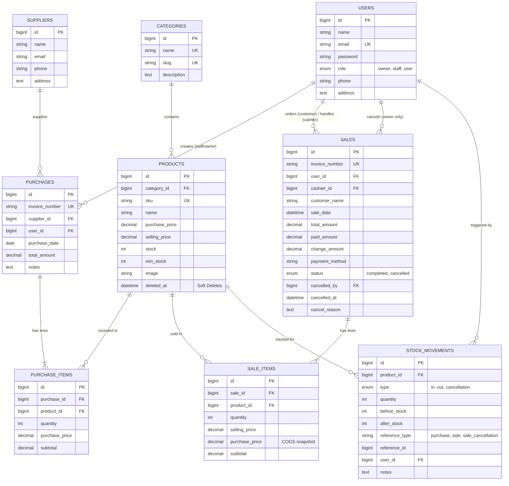

# TokoKu - Sistem Inventori dan Penjualan Retail Modern
> **UTS Web Programming 2 · Laravel 10 · PHP 8.1 · Laragon / MySQL**

---

## 1. Ringkasan Proyek & Tujuan Sistem
**TokoKu** adalah aplikasi web retail dan manajemen inventori terintegrasi yang menjamin data stok, transaksi multi-barang, struk invoice, dan etalase katalog produk selalu sinkron secara otomatis.

### 4 Masalah Bisnis & Solusi yang Diimplementasikan:
| No | Masalah Bisnis di Lapangan | Solusi di Sistem TokoKu |
|---|---|---|
| 1 | **Stok tidak dinamis & rawan manipulasi** | Stok **hanya berubah lewat transaksi** (Stok Masuk/Pembelian, Penjualan Kasir, dan Pembatalan). Tidak ada edit manual kuantitas stok di form produk. |
| 2 | **Catatan tidak sesuai penjualan** | Setiap perubahan fisik stok otomatis dicatat di tabel audit **`stock_movements`** (tipe `in`, `out`, `cancellation`) lengkap dengan referensi invoice dan user operator. |
| 3 | **Produk habis tapi masih tampil** | Katalog publik dan kasir menerapkan scope query ketat: **hanya produk dengan stok > 0 yang tampil**. |
| 4 | **Semua staf memakai dashboard yang sama** | Dashboard, navigasi menu, dan otorisasi hak akses **dibedakan per role** (Owner, Staff/Kasir, Pelanggan) dan diverifikasi di server (*Middleware, Gate/Policy*). |

---

## 2. Akun Demo Pengujian (UTS)
Untuk memudahkan pengujian dan penilaian, sistem menyediakan tombol **1-Click Login Cepat** di halaman `/login` dengan kredensial:

| Role | Nama Akun | Email | Password | Hak Akses Utama |
|---|---|---|---|---|
| **Owner (Pemilik Toko)** | Budi Santoso | `owner@tokoku.com` | `password` | Dashboard lengkap (omzet, laba kotor, forecasting SMA-7), CRUD master data, batalkan transaksi penjualan (retur stok), laporan penuh, kelola akun pengguna. |
| **Owner (Pemilik Toko)** | Zaki Yardan Siregar | `zaki@tokoku.com` | `password` | Hak akses penuh Owner. |
| **Staff / Admin Kasir** | Siti Rahma | `staff@tokoku.com` | `password` | Dashboard operasional harian, POS Kasir cepat, input stok masuk (pembelian), katalog read-only, laporan harian terbatas. Ditolak server (403) jika membatalkan transaksi. |
| **Staff / Admin Kasir** | Admin Operasional | `admin@tokoku.com` | `password` | Hak akses operasional staf kasir & inventori. |
| **Pelanggan (User)** | Andi Wijaya | `user@tokoku.com` | `password` | Akses katalog produk aktif (stok > 0), keranjang belanja, checkout mandiri multi-barang, dan riwayat struk belanja. |
| **Pelanggan (User)** | Rina Marlina | `pelanggan@tokoku.com` | `password` | Akun pelanggan toko. |
| **Pelanggan (User)** | Dewi Lestari | `pembeli@tokoku.com` | `password` | Akun pelanggan toko. |

---

## 3. Diagram Hubungan Entitas (ERD)



---

## 4. Alur Transaksi & Keamanan Bisnis

### A. Penjualan Multi-Barang (POS Kasir / Checkout)
1. Kasir atau pelanggan memilih satu atau beberapa barang dan menentukan jumlah unit.
2. Server melakukan verifikasi database dengan row locking (`lockForUpdate()`) dan mengambil harga jual terbaru langsung dari database (bukan input harga dari browser).
3. Seluruh proses dieksekusi di dalam satu blok transaksi database **`DB::transaction`**:
   - Simpan header `sales`.
   - Simpan tiap baris item `sale_items` lengkap dengan snapshot harga beli saat itu untuk perhitungan laba akurat.
   - Kurangi stok fisik produk.
   - Catat baris riwayat audit di `stock_movements` (tipe: `out`).
4. **Proteksi Stok Kurang & Rollback**: Jika salah satu produk yang diminta melebihi sisa stok, sistem melempar `InsufficientStockException`, membatalkan seluruh operasi database secara atomik, dan menampilkan pesan ramah tanpa error 500 / stack trace:
   > *"Stok untuk produk '[Nama]' tidak mencukupi. Diminta: X, Tersedia: Y."*

### B. Pembatalan Transaksi (Khusus Owner)
1. Hanya akun ber-role **Owner** yang memiliki wewenang membatalkan transaksi berstatus `completed`.
2. Pengujian otorisasi dicek ganda di level server via Middleware `role:owner` dan Policy `SalePolicy@cancel`. Jika role Staff mencoba menembak URL pembatalan, server langsung mengembalikan status **403 Forbidden**.
3. Di dalam transaksi database atomik:
   - Status invoice diubah menjadi `cancelled`.
   - Disimpan metadata siapa yang membatalkan (`cancelled_by = auth()->id()`), kapan dibatalkan (`cancelled_at = now()`), dan alasan pembatalan (`cancel_reason`).
   - Seluruh item transaksi dikembalikan stoknya ke tabel `products`.
   - Mutasi stok dicatat di `stock_movements` (tipe: `cancellation`).
4. Transaksi yang sudah berstatus `cancelled` tidak dapat dibatalkan untuk kedua kalinya (`TransactionAlreadyCancelledException`).

### C. Stok Masuk (Penerimaan Barang Supplier)
1. Staff atau Owner memilih pemasok dan menambahkan multi-item barang yang diterima.
2. Stok produk bertambah secara otomatis dan tercatat dengan tipe `in` di `stock_movements`.
3. Harga beli master produk terbarui otomatis sesuai nota penerimaan terbaru.

---

## 5. Struktur Arsitektur Bersih (Laravel 10 Clean Architecture)

Sistem dirancang dengan pola *Thin Controllers, Fat Services* sehingga mudah dijelaskan pada sesi wawancara koding:

```
app/
 ├─ Http/Controllers/
 │   ├─ AuthController.php          # Login, Register, Logout, Error message
 │   ├─ DashboardController.php     # Metrik per role & JSON polling endpoint
 │   ├─ CatalogController.php       # Katalog stok > 0, keranjang, checkout
 │   ├─ ProductController.php       # Master produk & soft delete
 │   ├─ CategoryController.php      # Master kategori & auto slug
 │   ├─ SupplierController.php      # Master pemasok
 │   ├─ PurchaseController.php      # Stok masuk multi-item
 │   ├─ SaleController.php          # POS Kasir & pembatalan owner
 │   ├─ StockMovementController.php # Log audit mutasi stok
 │   ├─ ReportController.php        # Laporan penjualan, laba rugi, nilai aset
 │   └─ UserController.php          # Manajemen user (Owner only)
 ├─ Http/Middleware/
 │   └─ RoleMiddleware.php          # Pembatasan role:owner, role:owner,staff
 ├─ Http/Requests/
 │   ├─ StoreProductRequest.php     # Tanpa field edit stok manual
 │   ├─ UpdateProductRequest.php    # Tanpa field edit stok manual
 │   ├─ StorePurchaseRequest.php    # Validasi multi-item penerimaan
 │   ├─ StoreSaleRequest.php        # Validasi multi-item checkout
 │   ├─ CancelSaleRequest.php       # Alasan pembatalan minimal 5 karakter
 │   ├─ StoreCategoryRequest.php    # Nama kategori unik
 │   ├─ StoreSupplierRequest.php    # Validasi pemasok
 │   └─ UserRequest.php             # Validasi akun & role
 ├─ Models/
 │   ├─ User.php, Category.php, Supplier.php
 │   ├─ Product.php (dengan SoftDeletes & scopeAvailableForCatalog)
 │   ├─ Purchase.php & PurchaseItem.php
 │   ├─ Sale.php & SaleItem.php
 │   └─ StockMovement.php
 ├─ Policies/
 │   ├─ SalePolicy.php              # Strict cancel hanya owner
 │   └─ ProductPolicy.php           # Strict modifikasi hanya owner
 ├─ Services/
 │   ├─ StockService.php            # Logika mutasi stok & integritas angka
 │   ├─ SaleService.php             # Transaksi atomik checkout & pembatalan
 │   └─ PurchaseService.php         # Transaksi atomik penerimaan stok
 └─ Exceptions/
     ├─ InsufficientStockException.php
     └─ TransactionAlreadyCancelledException.php
```

---

## 6. Dashboard Dinamis & Live Polling

- **Query Agregat Nyata**: Tidak ada angka hardcoded. Seluruh metrik omzet, laba kotor, jumlah transaksi, dan peringatan stok menipis dihitung langsung melalui query database (`SUM`, `COUNT`, `DB::raw`).
- **Live Polling Chart.js**: Grafik tren penjualan 7 hari dan distribusi kategori mengambil data secara asynchronous melalui endpoint JSON `/api/dashboard-charts` setiap **10 detik**. Setelah kasir memproses transaksi atau owner membatalkan transaksi, grafik dan metrik angka di dashboard akan terbarui otomatis tanpa perlu me-reload halaman.
- **Fitur Forecasting (Prediksi Penjualan)**: Menggunakan algoritma **Simple Moving Average (SMA-7)** untuk memproyeksikan estimasi omzet harian berikutnya dan memberikan rekomendasi kebutuhan restok barang.

---

## 7. Cara Instalasi & Menjalankan di Laragon

1. Buka terminal di direktori proyek:
   ```bash
   cd d:\laragon\www\TokoKu
   ```

2. Pastikan file `.env` sudah mengarah ke database MySQL Laragon:
   ```env
   DB_CONNECTION=mysql
   DB_HOST=127.0.0.1
   DB_PORT=3306
   DB_DATABASE=tokoku
   DB_USERNAME=root
   DB_PASSWORD=
   ```

3. Jalankan migrasi dan seeder data contoh:
   ```bash
   php artisan migrate:fresh --seed
   ```

4. Buat symlink storage untuk gambar produk:
   ```bash
   php artisan storage:link
   ```

5. Jalankan server lokal:
   ```bash
   php artisan serve
   ```
   Aplikasi dapat diakses melalui browser di: `http://localhost:8000` atau melalui virtual host Laragon di `http://tokoku.test`.

---

## 8. Verifikasi & Hasil Pengujian Otomatis (Unit & Feature Test)

Sistem telah dilengkapi rangkaian uji otomatis menggunakan PHPUnit / Pest pada file `tests/Feature/TokoKuSystemTest.php`. Jalankan perintah pengujian:

```bash
php artisan test --filter=TokoKuSystemTest
```

### Hasil Uji:
```
   PASS  Tests\Feature\TokoKuSystemTest
  ✓ login with invalid credentials returns error message
  ✓ staff cannot cancel sale (403 Forbidden verified)
  ✓ staff cannot create category (403 Forbidden verified)
  ✓ catalog only displays products with stock greater than zero
  ✓ chart polling endpoint returns valid data
  ✓ sale decreases stock and owner cancel restores it
  ✓ insufficient stock throws exception and rolls back

  Tests:    7 passed (26 assertions)
  Duration: 3.55s
```
Semua 7 skenario pengujian utama berhasil lulus dengan **26 assertions** tanpa kegagalan.
